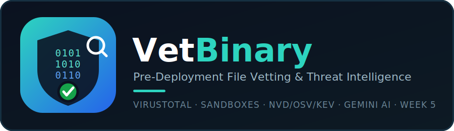

<p align="center">
  
</p>

<p align="center">
  
  
  
  
  
  
</p>

<p align="center">
  <b>Before it goes on a company laptop, know what it actually is, and what it actually does.</b>
</p>

<p align="center">
  <a href="#-quick-start">Quick start</a> ·
  <a href="#-why-vetbinary-exists">Why this exists</a> ·
  <a href="#-how-it-works">How it works</a> ·
  <a href="#-api-keys">API keys</a> ·
  <a href="#-security-notes-and-honest-limitations">Limitations</a>
</p>

---

## 📌 Table of contents
- [Why VetBinary exists](#-why-vetbinary-exists)
- [Who this helps](#-who-this-helps)
- [Why this is different from a single antivirus scan](#-why-this-is-different-from-a-single-antivirus-scan)
- [Features](#-features)
- [How it works](#-how-it-works)
- [API keys](#-api-keys)
- [Quick start](#-quick-start)
- [Usage](#-usage)
- [Example output](#-example-output)
- [Project structure](#-project-structure)
- [Testing](#-testing)
- [Safety controls actually implemented](#-safety-controls-actually-implemented)
- [Security notes and honest limitations](#-security-notes-and-honest-limitations)
- [Roadmap](#-roadmap)
- [Contributing](#-contributing)
- [Author](#-author)
- [License](#-license)

---

## 🎯 Why VetBinary exists

IT and security teams are regularly asked to approve a new tool before it goes on a corporate machine, a dev utility, a monitoring agent, an installer someone found online. The usual check is one antivirus scan and a shrug. That misses two different risks: **is this specific file malicious**, and separately, **does this software have a known vulnerability history**, which a clean AV scan says nothing about.

**VetBinary answers both, from one upload.** It extracts the file's real identity from its own metadata (not the filename), checks it against VirusTotal and cloud sandboxes, researches the product's CVE history against NVD, OSV.dev and CISA's actively-exploited list, then runs everything through Gemini AI twice, once as a fast pre-flight check, once as a final false-positive audit, before it hands you one verdict: safe to deploy, do not deploy, or needs a human to look closer.

---

## 👥 Who this helps

| Audience | What VetBinary gives them |
|---|---|
| **IT / corporate deployment teams** | A documented, repeatable check before approving any new tool, with a plain verdict and an audit trail to point to later |
| **SOC / security teams** | A second opinion that cross-references multiple independent sources instead of trusting one AV engine |
| **Anyone evaluating a replacement tool** (a new Postman, a new editor, a new utility) | A fast way to confirm it's genuinely the real, unmodified software before it's trusted |

---

## 🛡️ Why this is different from a single antivirus scan

| One antivirus scan | **VetBinary** |
|---|---|
| Tells you if a signature matched, nothing about the product's history | Separately researches the product's known CVEs (NVD), bundled open-source vulnerabilities (OSV.dev), and whether any of them are actively being exploited right now (CISA KEV) |
| One engine's opinion | VirusTotal's full engine breakdown, plus Hybrid Analysis sandbox telemetry, cross-correlated, not just added up |
| A single flag is treated as fact | A lone engine detection is `needs_review`, not confirmed; confirming something malicious requires multiple engines agreeing, or an engine flag backed by real sandbox behavior |
| Generic labels ("Generic.Malware", "Heuristic") treated the same as a named family | Down-weighted automatically, generic/packer/PUP labels don't carry the same weight as a specific detection |
| No context on *why* something fired | Gemini AI audits every candidate CVE against the exact installed version and platform, and separates normal installer behavior (NSIS helper DLLs, temp file drops) from genuine sandbox red flags |
| You find out about a vulnerable bundled library yourself, later | Checked automatically against OSV.dev and CISA's exploited-in-the-wild list before you approve anything |

> **Honest note:** VetBinary augments a deployment decision, it does not replace enterprise endpoint security controls (EDR, AppLocker, and similar). See [Security notes and honest limitations](#-security-notes-and-honest-limitations).

---

## ✨ Features

**Upload & identity**
- Accepts files up to 650 MB, with SHA-256 computed on upload
- Extracts real software identity from the file itself: PE version resource fields (ProductName, ProductVersion, CompanyName, FileDescription), Authenticode signer parsed directly from the PE's PKCS#7 certificate, and MSI installer identity via raw OLE2 compound-document parsing
- A heuristic fallback identifies popular installers (Notepad++, Chrome, VLC, PotPlayer, KMPlayer, Postman, and others) when metadata alone isn't conclusive

**Reputation & threat intelligence**
- VirusTotal API v3 hash lookup: full engine breakdown, detection ratio, threat category
- Hybrid Analysis (Falcon Sandbox) integration: hash overview and full execution telemetry, dropped files, spawned processes, network connections, MITRE ATT&CK techniques
- ANY.RUN integration is coded with pre-submission eligibility checks, but a free Community key cannot submit via API, so this service reports itself as skipped with a clear reason rather than failing silently
- NVD CVE API 2.0 lookup, exact-CPE match preferred over keyword fallback
- OSV.dev lookup for bundled open-source components
- CISA Known Exploited Vulnerabilities catalog cross-check, cached in memory for 24 hours, to flag any matched CVE that's being actively exploited right now

**AI layer (Gemini)**
- A fast pre-flight check at the start of the pipeline for known zero-days or active supply-chain compromises
- A final false-positive elimination pass that audits every candidate CVE for version/platform mismatch, distinguishes normal installer behavior from genuine malware behavior, and can adjust the verdict with its reasoning shown
- A heuristic fallback engine runs the equivalent checks if `GEMINI_API_KEY` isn't configured

**Verdict, scoring & reporting**
- One of three verdicts: `SAFE_TO_DEPLOY`, `NEEDS_MANUAL_REVIEW`, `DO_NOT_DEPLOY`, with a 0-100 risk score
- Specific remediation: Windows Defender Firewall egress rules, AppLocker/WDAC allow-listing, EDR monitoring guidance
- Every external API call logged (service, endpoint, status, outcome, latency, timestamp) and shown in the report
- Downloadable PDF report and a browsable HTML report
- Live scan progress via Server-Sent Events, plus REST status polling

---

## 🔬 How it works

```
 1. Upload: file + purpose comment + deployment scope + sandbox-sharing consent
         │
         ▼
 2. Compute SHA-256. Extract real identity: PE version info / Authenticode signer /
    MSI OLE2 stream, or the known-installer heuristic as a fallback
         │
         ▼
 3. Gemini AI pre-flight check: any known zero-day or active supply-chain compromise?
         │
         ▼
 4. VirusTotal hash lookup  +  eligibility check against each sandbox's size/quota limits
    (only eligible, consented sandboxes are called — Hybrid Analysis; ANY.RUN reports
    itself skipped on a free key)
         │
         ▼
 5. In parallel: NVD CVE lookup (exact CPE, else keyword) + OSV.dev (bundled components)
    + cross-check every CVE found against the live CISA KEV list
         │
         ▼
 6. Gemini AI false-positive pass: audits every candidate finding against the real
    version/platform, separates installer-normal behavior from genuine red flags
         │
         ▼
 7. Verdict + 0-100 risk score + remediation  →  PDF / HTML report, every source
    and every API call logged
```

---

## 🔑 API keys

| Key | Required? | Confirmed working | Get it at |
|---|---|---|---|
| `VT_API_KEY` | Required | ✅ Yes | https://www.virustotal.com/gui/join-us |
| `HYBRID_ANALYSIS_API_KEY` | Optional (sandbox analysis skipped without it) | ✅ Yes | https://hybrid-analysis.com |
| `GEMINI_API_KEY` | Optional (a heuristic fallback runs without it) | ✅ Yes | https://aistudio.google.com |
| `NVD_API_KEY` | Optional (raises the NVD rate limit) | ✅ Yes | https://nvd.nist.gov/developers/request-an-api-key |
| `ANYRUN_API_KEY` | Optional | ⚠️ Not working on free tier — ANY.RUN's Community plan doesn't include API submission rights, so this always reports itself skipped | https://any.run |

Copy `.env.example` to `.env` and fill in the keys you have. VirusTotal is the only one that's genuinely required for the app to produce a result.

---

## 🚀 Quick start

### With Docker

```bash
git clone https://github.com/RavinduChamika1/VetBinary.git
cd VetBinary
cp .env.example .env    # fill in VT_API_KEY, HYBRID_ANALYSIS_API_KEY, GEMINI_API_KEY
docker compose up --build
```

### Without Docker

**Backend**
```bash
cd backend
python -m venv .venv
.venv\Scripts\activate        # Windows
# source .venv/bin/activate   # Mac/Linux
pip install -r requirements.txt
uvicorn main:app --host 127.0.0.1 --port 8000
```

**Frontend** (in a separate terminal)
```bash
cd frontend
npm install
npm run dev
```

- Frontend: **http://localhost:3000**
- Backend API & Swagger docs: **http://localhost:8000/docs**

---

## 💻 Usage

1. Open the frontend and upload the file you're evaluating.
2. Add a purpose comment (why it's being tested) and the deployment scope (where it would be installed).
3. Confirm whether you allow submission to public cloud sandboxes, free-tier sandbox submissions can be publicly visible to other users of that platform, so leave this off for anything sensitive.
4. Watch the live progress as each source is checked.
5. Read the verdict banner at the top of the results page, then open any section below it (VirusTotal, sandbox telemetry, CVE history, Gemini's reasoning, the full API call log) for detail.
6. Download the PDF or view the HTML report for your records.

---

## 📺 Example output

A real run against a genuine, signed Notepad++ 8.9.8 installer:

```json
{
  "at_a_glance": {
    "verdict": "SAFE_TO_DEPLOY",
    "risk_score": 0.0,
    "one_line_reason": "Gemini AI verified candidate findings as false positives: Notepad++ version 8.9.8 installer is a legitimate, officially signed binary from NOTEPAD++ with zero antivirus engine detections across 75 vendors. The sandbox behavioral triggers represent normal NSIS installer execution traits, and all candidate CVEs are historical version mismatches."
  }
}
```

In that run, 20 candidate CVEs were found by the NVD/OSV lookup, Gemini's false-positive pass checked each against the installer's actual version and filtered all 20 out as historical version mismatches, rather than the report wrongly listing them as current risks.

*(Add a dashboard screenshot here once you have one, e.g. `assets/demo.png`, this repo doesn't have one yet.)*

---

## 🗂️ Project structure

```
VetBinary/
├── docker-compose.yml
├── test_scan.py
├── backend/
│   ├── Dockerfile
│   ├── config.py
│   ├── database.py
│   ├── main.py
│   ├── models.py
│   ├── requirements.txt
│   ├── schemas.py
│   ├── test_scan_flow.py
│   ├── routers/
│   │   ├── report.py
│   │   └── scan.py
│   ├── services/
│   │   ├── anyrun.py
│   │   ├── cisa_kev.py
│   │   ├── file_identity.py
│   │   ├── gemini_analyzer.py
│   │   ├── hybrid_analysis.py
│   │   ├── nvd.py
│   │   ├── osv.py
│   │   ├── report_gen.py
│   │   ├── verdict.py
│   │   └── virustotal.py
│   └── utils/
│       ├── logging_utils.py
│       └── quota.py
├── data/
│   └── uploads/
└── frontend/
    ├── Dockerfile
    ├── nginx.conf
    ├── package.json
    ├── vite.config.js
    └── src/
        ├── App.jsx
        ├── api.js
        ├── components/
        │   ├── ApiCallLogSection.jsx
        │   ├── CVESection.jsx
        │   ├── EligibilityTable.jsx
        │   ├── FindingsSection.jsx
        │   ├── GeminiAISection.jsx
        │   ├── ProgressLog.jsx
        │   ├── RemediationSection.jsx
        │   ├── SandboxSection.jsx
        │   ├── SourcesTable.jsx
        │   ├── VerdictBanner.jsx
        │   └── VirusTotalSection.jsx
        └── pages/
            ├── ResultsPage.jsx
            └── UploadPage.jsx
```

---

## 🧪 Testing

There's no pytest suite configured here, instead there are two async integration scripts that run against a live backend:

| File | What it does |
|---|---|
| `backend/test_scan_flow.py` | Submits a real binary, polls the scan via the REST API, and asserts on the verdict, risk score, VirusTotal detections, Hybrid Analysis telemetry, CVE count, Gemini's false-positive filtering, and that the PDF report generates successfully |
| `test_scan.py` | Submits a dummy PE binary to check the endpoint is healthy and the response is shaped correctly |

```bash
python backend/test_scan_flow.py
```

The most recent verified run completed with a `SAFE_TO_DEPLOY` verdict, a 0.0 risk score, 20 candidate CVEs correctly filtered as false positives, and a 200 OK PDF report, run this yourself to confirm on your machine before relying on it.

---

## 🔒 Safety controls actually implemented

- **No local execution of uploaded files.** Analysis is static (pefile / cryptography) or runs remotely in a cloud sandbox; uploaded files are stored without execute permissions.
- **Sandbox sharing consent gate.** `allow_public_sandbox_sharing` must be explicitly true before anything is sent to Hybrid Analysis or ANY.RUN.
- **Per-service eligibility checked before every call**, against both file size and the service's monthly quota.
- **Every outbound API request is logged** to the database, timestamped.
- **Keys are read only from environment variables**, via `config.py`, and are never returned to the frontend or written to logs.

---

## 🛡️ Security notes and honest limitations

- **In VetBinary's own words**, from the in-app disclaimer: *"This vetting report is based strictly on current, verified telemetry from public intelligence, dynamic sandboxes, and AI verification. It does not replace internal enterprise endpoint security controls (EDR, AppLocker, etc.)."*
- **ANY.RUN doesn't actually work on a free key.** Its Community plan doesn't include API submission rights, so that integration is coded but always reports itself skipped. Hybrid Analysis is the sandbox that's genuinely functional here.
- **Hybrid Analysis's free plan is limited** to roughly 30 uploads per month and 100 MB per file.
- **Free-tier sandbox submissions can be public.** Anything submitted to Hybrid Analysis without a paid tier may be discoverable by other users of that platform, hence the explicit consent gate.
- **The CISA KEV list is cached for 24 hours**, not re-fetched on every single scan. The report shows when each source was checked, so you can see the age for yourself.
- **This is a decision-support tool**, not a replacement for antivirus, EDR, or a proper enterprise software approval process.

---

## 🗺️ Roadmap

Part of **52 Weeks of Security**: one new cybersecurity project every week.

- [x] **Week 1:** [PassVigil](https://github.com/RavinduChamika1/passvigil), password strength and breach checker
- [x] **Week 2:** [HashKiln](https://github.com/RavinduChamika1/hashkiln), password hashing lab
- [x] **Week 3:** [MimicLens](https://github.com/RavinduChamika1/mimiclens), phishing URL detector
- [x] **Weeks 4-6:** [BreachSieve](https://github.com/RavinduChamika1/breachsieve), AI-augmented vulnerability assessment platform
- [x] **Week 5:** VetBinary, pre-deployment file vetting and threat intelligence
- [ ] More coming every week

Next steps already identified from the codebase: automated polling for samples still queued in public sandboxes, support for local/on-premise sandbox connectors (CAPEv2 / Cuckoo) for air-gapped environments, and a CLI tool for CI/CD binary vetting.

---

## 🤝 Contributing

1. Fork the repository
2. Create a branch: `git checkout -b feature/your-idea`
3. Make your changes and run `python backend/test_scan_flow.py`
4. Commit and push, then open a Pull Request

Found a bug or have an idea? [Open an issue](https://github.com/RavinduChamika1/VetBinary/issues).

---

## 👤 Author

**Ravindu Chamika**

[](https://www.linkedin.com/in/ravindu-chamika/)
[](https://github.com/RavinduChamika1)

If this helped you learn something, please ⭐ the repo and follow the series.

---

## 📄 License

Copyright © 2026 **Ravindu Chamika**. Released under the [MIT License](LICENSE).

<p align="center"><sub>Built for authorized, consent-aware security testing · 52 Weeks of Security · Week 5</sub></p>
